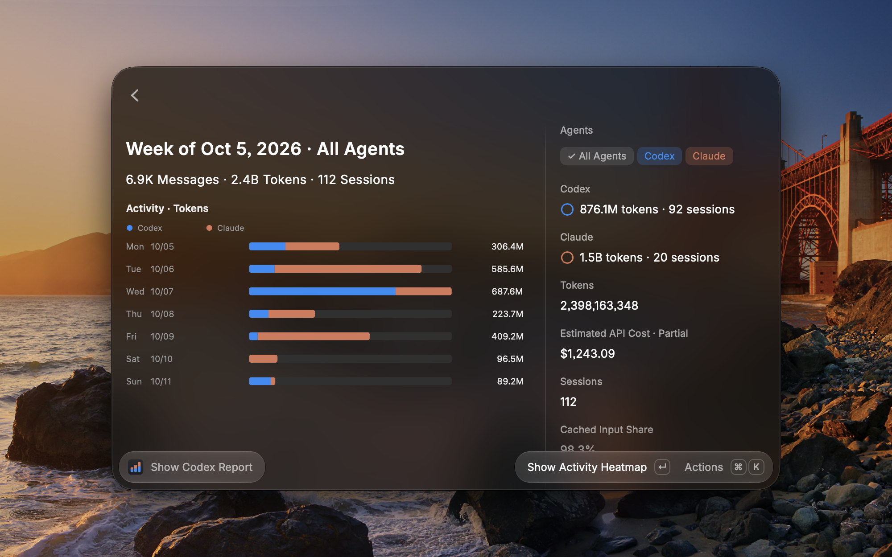
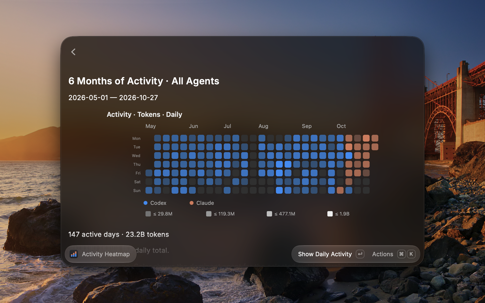

# codex-report

A tiny CLI that shows how much you're actually burning with Codex and Claude Code.

It reads local Codex and Claude Code transcripts and reports sessions, messages,
tokens, models, projects, repositories, tools, skills, daily and monthly activity,
and estimated API-equivalent costs. Parsed sessions are cached locally, so repeated
reports are fast. Everything stays on your machine.

## Quick start

```bash
npx codex-report               # run without installing
npm install -g codex-report    # or install globally
```

Requires Node.js 22.15.0 or newer; there are no other dependencies.

## Usage

```bash
codex-report                                  # current folder, all available history
codex-report --global                         # all local sessions
codex-report --from 2026-04-01 --to 2026-04-28
codex-report --top 5                          # shorter top lists
```

Print only selected sections without the boxed summary:

```bash
codex-report --models --tools
codex-report --global --repositories
codex-report --global --weekly --activity --top 5
```

Section flags: `--agents`, `--weekly`, `--monthly`, `--projects`, `--repositories`,
`--models`, `--tools`, `--activity`, `--sources`, `--providers`, `--costs`,
`--insights`, and `--skills`. `--json` prints one JSON object for scripts,
`--no-cache` bypasses the session cache, and `--clear-cache` deletes it.

### Claude Code and combined reports

The default agent is Codex. Choose Claude Code or both agents explicitly; all other
options work the same:

```bash
codex-report --agent claude --global --models --costs
codex-report --agent all --global
codex-report --agent all --agents    # per-agent totals
```

### Costs

API costs are API-equivalent estimates from local token counts and list prices,
not billing data or subscription fees. Models without a known price are shown as
unpriced. See [Cost Estimation](docs/cost-estimation.md) for the calculation.

## Example output

```text
$ codex-report --global

┌─ codex-report ───────────────────────────────────────────────────────────────────────┐
│ Scope       global                                                                   │
│ Period      2025-09-19 → 2026-08-15                                                  │
│ Sessions    1,026                                                                    │
│ Projects    89                                                                       │
│ Repos/dirs  50                                                                       │
│ Messages    85,651 (19,598 user, 66,053 assistant)                                   │
│ Tokens      16,080,902,795 total                                                     │
│             16,030,807,609 input · 15,051,904,000 cached · 50,095,186 output         │
│ API cost    $10,636 estimated from priced local tokens                               │
│             265M tokens in unpriced models                                           │
│ Active days 202 · longest streak 28 days                                             │
│ Busiest day 2026-06-23 (2,796 messages)                                              │
│                                                                                      │
│ Top repositories and directories                                                     │
│   github.com/acme/client                         837 sessions  █████████████░░░  82% │
│   github.com/acme/backend                         90 sessions  █░░░░░░░░░░░░░░░   9% │
│   ~/code/local-tool                               22 sessions  █░░░░░░░░░░░░░░░   2% │
│                                                                                      │
│ Top models                                                                           │
│   gpt-5.2-codex                                   6,689 turns  ███░░░░░░░░░░░░░  20% │
│   gpt-5.5                                         5,918 turns  ███░░░░░░░░░░░░░  18% │
│   gpt-5.4                                         4,753 turns  ██░░░░░░░░░░░░░░  14% │
│                                                                                      │
│ Estimated API cost by model                                                          │
│   gpt-5.5                            $5,019  5.9B in · 5.6B cached · 15M out     47% │
│   gpt-5.6-sol                        $3,129  4.4B in · 4.2B cached · 10M out     29% │
│   gpt-5.4                            $1,990  3.9B in · 3.5B cached · 15M out     19% │
│   unpriced: (unknown), codex-auto-review, gpt-5.3-codex-spark                        │
└──────────────────────────────────────────────────────────────────────────────────────┘
```

## Raycast extension

A Raycast extension for macOS lives in [`raycast`](raycast). It bundles the CLI
and runs it with Raycast's own Node runtime, so it needs neither Node.js nor the
npm package. It is not published in the Raycast Store yet.





See the [Raycast README](raycast/README.md) for features, shortcuts, and local
development.

## More details

- [How it works](docs/how-it-works.md): data locations, counting rules, caching,
  and JSON output
- [Cost Estimation](docs/cost-estimation.md): prices and assumptions behind the
  estimates
- [Agent adapters](docs/agent-adapters.md): how agents are read and how to add
  another one
